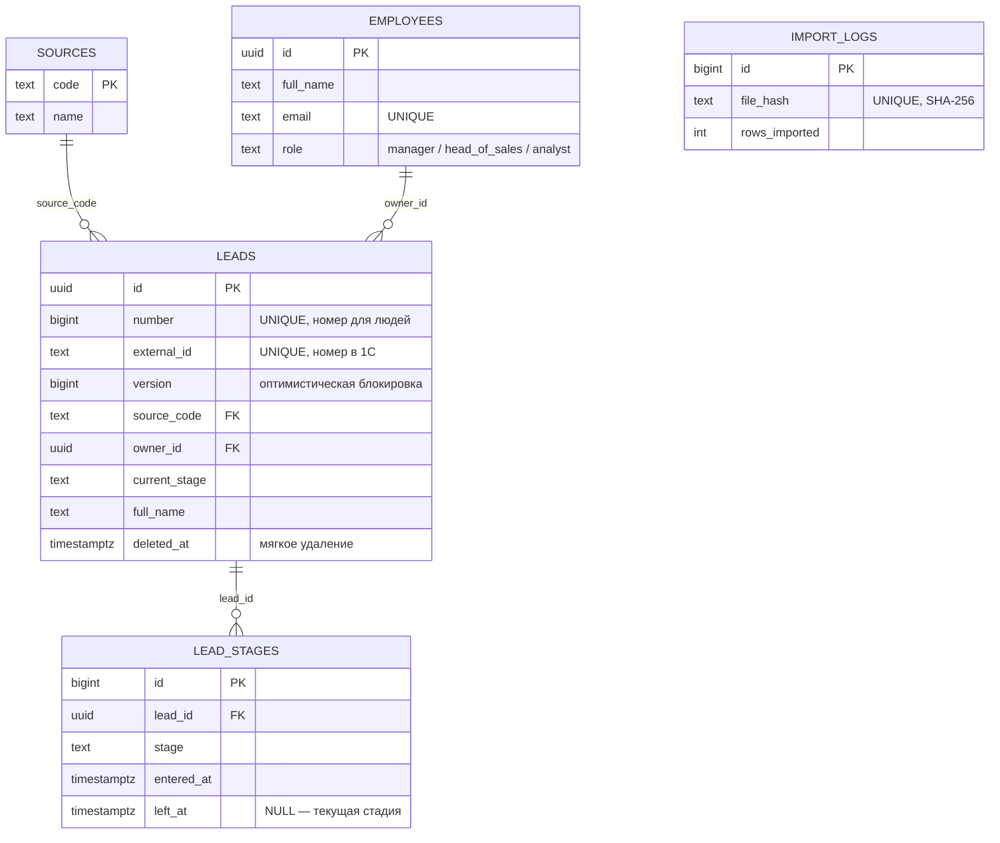

# CRM-mini — лиды и воронка продаж

REST API на Go для учёта лидов (потенциальных клиентов) и их движения по воронке продаж:
`new → qualified → proposal → won | lost`.

Командный учебный проект (весна 2026, кейс «CRM-mini»): веб-интерфейс, учётный контур на 1С
и бэкенд на Go. Я отвечал за Go-бэкенд. Осенью 2026 я переписал его с нуля на слоистой
архитектуре — подробнее в разделе [«История проекта»](#история-проекта).

**Стек:** Go 1.26 · PostgreSQL 18 · pgx/v5 · net/http (Go 1.22 routing) · zap · caarlos0/env ·
golang-migrate · Docker Compose · Make

## Что внутри

| Метод | Путь | Что делает |
|---|---|---|
| `GET` | `/api/v1/health` | жив ли сервис и доступна ли база (200 / 503) |
| `GET` | `/api/v1/sources` | справочник источников лидов |
| `POST` | `/api/v1/sources` | добавить источник (409, если код занят) |
| `POST` | `/api/v1/leads` | создать лида |
| `GET` | `/api/v1/leads` | список с фильтрами `source`, `owner_id`, `stage` и страницами `limit`, `offset` |
| `GET` | `/api/v1/leads/{id}` | один лид |
| `PATCH` | `/api/v1/leads/{id}` | изменить присланные поля (оптимистическая блокировка по `version`) |
| `DELETE` | `/api/v1/leads/{id}` | мягкое удаление |
| `POST` | `/api/v1/leads/{id}/stage` | перевести лида в другую стадию по правилам воронки |
| `POST` | `/api/v1/leads/import` | идемпотентный импорт выгрузки из 1С (повтор файла — 409) |
| `GET` | `/api/v1/reports/funnel` | отчёт «Воронка»: конверсия между стадиями и среднее время в стадии |

Ошибки всегда приходят в одном формате: `{"error": "..."}` с кодом 400 / 404 / 409 / 500.
У каждого ответа есть заголовок `X-Request-ID` — по нему запрос находится в логах сервера.

## Инженерные решения

**Конкурентный доступ**
- **Оптимистическая блокировка.** У лида есть `version`. Изменение проходит только при совпадении
  версии (`UPDATE … WHERE id = $1 AND version = $2`), иначе — 409. Так правка одного менеджера
  не затирает правку другого (lost update).
- **Гонка «won и lost одновременно» закрыта дважды:** блокировкой строки при `UPDATE` с проверкой
  версии и частичным уникальным индексом «у лида одна открытая стадия»
  (`UNIQUE (lead_id) WHERE left_at IS NULL`).
- **Транзакции.** Создание лида вместе с первой записью истории и смена стадии
  (обновить лида → закрыть стадию → открыть новую) — атомарные операции.

**Целостность данных**
- Правила воронки — в доменном коде (`Stage.CanMoveTo`): только на шаг вперёд, в `lost` — из любой
  незакрытой стадии, из `won`/`lost` — никуда.
- Правила данных продублированы в базе: `CHECK`, внешние ключи, частичные индексы. База — последний
  рубеж, даже если в коде ошибка.
- Мягкое удаление (`deleted_at`): лид пропадает из API, но остаётся в базе вместе с историей.
- ID — UUID v7, генерируется в Go: идентификатор известен до вставки, а время в начале UUID
  даёт упорядоченные вставки в индекс первичного ключа.

**Надёжность и безопасность**
- Ошибки переводятся на границах слоёв: ошибки Postgres → общие ошибки приложения (`apperr`) →
  HTTP-коды. Детали 500-х уходят только в лог, клиент видит общий текст.
- SQL только с параметрами `$1, $2…` — в том числе в динамическом `WHERE` для фильтров.
- HTTP-сервер: плавная остановка по `SIGINT`/`SIGTERM`, `ReadHeaderTimeout` и `IdleTimeout`
  (защита от Slowloris), лимит размера тела запроса.
- Middleware: `request_id`, access log, CORS по белому списку, перехват паник.
- Конфигурация из переменных окружения с проверкой при старте: приложение не запустится
  с неполными или неверными настройками.

## Архитектура

```
HTTP → middleware → handler (transport) → service (правила) → repository (SQL) → PostgreSQL
```

Каждая фича — отдельный пакет; слои внутри — отдельные файлы. Сервис зависит от интерфейса хранилища,
который сам и объявляет, — поэтому его можно тестировать без базы.

```
cmd/crm/                 точка входа: конфиг, логгер, пул, сборка зависимостей, запуск
internal/core/           общее для всех фич
├── apperr/              общие ошибки приложения
├── httpserver/          HTTP-сервер с graceful shutdown
├── logger/              zap и логгер в контексте запроса
├── middleware/          request_id, access log, CORS, recover
├── postgres/            пул соединений pgx и ошибки Postgres
├── request/             чтение JSON и параметров запроса
└── respond/             единый формат ответов и ошибок
internal/features/
├── health/              проверка доступности
├── sources/             справочник источников
└── leads/               лиды: CRUD, смена стадий
migrations/              SQL-миграции (golang-migrate)
testdata/                тестовая выгрузка из 1С (120 лидов)
```

## Схема данных



Таблицы лежат в схеме `crm` и создаются миграциями из `migrations/`.

## Запуск локально

Понадобятся **Go 1.26+**, **Docker** (с Docker Compose) и **make**.

```bash
cp .env.example .env          # задай свой POSTGRES_PASSWORD
make env-up                   # PostgreSQL в Docker
make migrate-up               # схема БД и справочник источников
make env-port-forwarder       # открыть базу для приложения на 127.0.0.1:5432
make crm-run                  # API на http://127.0.0.1:8080
curl -X POST --data-binary @testdata/seed_leads.json http://127.0.0.1:8080/api/v1/leads/import
```

Проверка:

```bash
curl http://127.0.0.1:8080/api/v1/health
curl http://127.0.0.1:8080/api/v1/sources
curl "http://127.0.0.1:8080/api/v1/leads?source=site&stage=qualified&limit=20"
```

`make help` покажет все команды. Остановить окружение — `make env-down`, удалить вместе с данными —
`make env-cleanup`.

## История проекта

- **Весна 2026 — курсовой проект команды.** Веб-интерфейс на JavaScript, учётный контур на 1С
  (`1c/`) и Go-бэкенд на GORM и gorilla/mux (`main.go`, `internal/handlers`, `internal/models`) —
  это моя часть.
- **Осень 2026 — переписывание бэкенда.** Новый бэкенд (`cmd/crm`, `internal/core`, `internal/features`)
  сделан с нуля: чистый SQL на pgx вместо ORM, стандартный `net/http` вместо gorilla/mux, миграции
  вместо автосоздания таблиц, слои transport → service → repository. По ходу закрыты проблемы
  старой версии: гонка при генерации ID, гонка при смене стадии, утечка текста ошибок клиенту,
  открытый прокси (SSRF).

Старый бэкенд пока лежит рядом с новым: веб-интерфейс ещё работает с ним. Он будет удалён,
когда сайт переедет на `/api/v1`.

## Статус

- [x] Окружение: PostgreSQL в Docker, миграции, Makefile
- [x] Ядро: конфиг, логгер, пул соединений, HTTP-сервер, middleware, ошибки
- [x] Источники, лиды (CRUD, фильтры, оптимистическая блокировка), смена стадий
- [x] Идемпотентный импорт выгрузки из 1С
- [x] Отчёт «Воронка»: конверсия и время в стадиях на SQL
- [ ] Тесты и CI
- [ ] Перевод веб-интерфейса на новый API, удаление старого бэкенда, Docker-образ приложения
